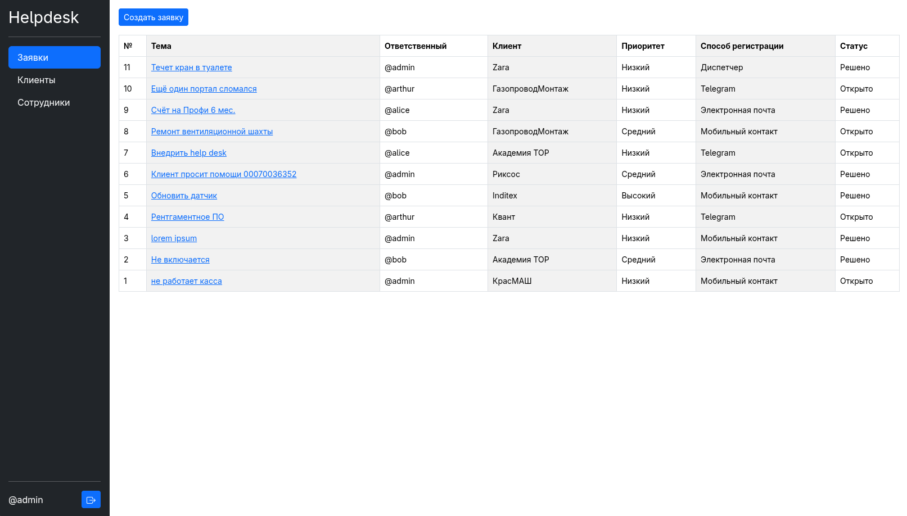
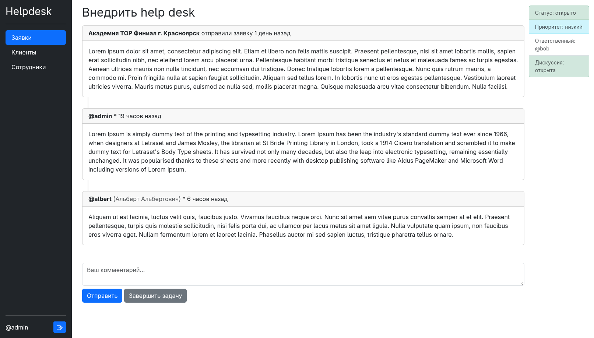
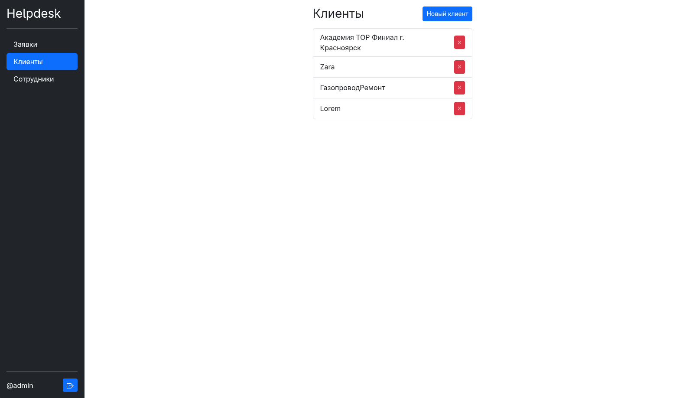
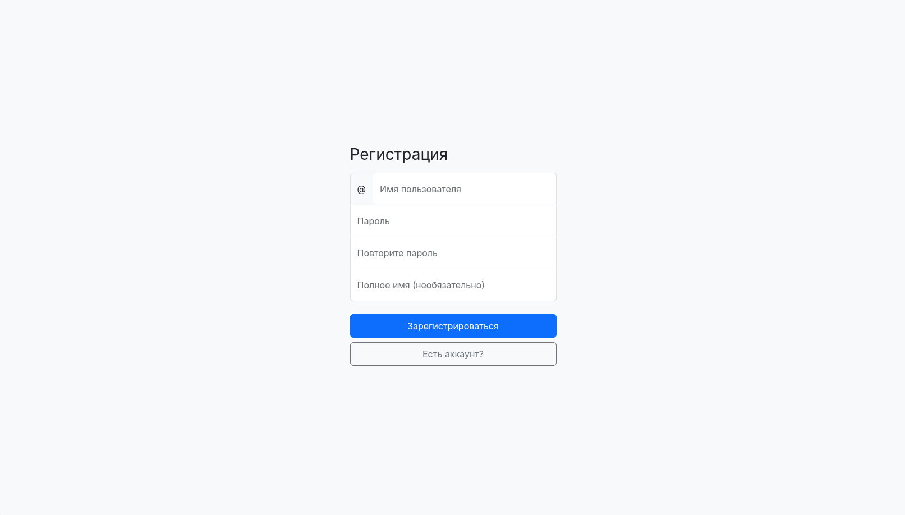

# Корпорпативный Helpdesk









## Развертывание

1. Установка uv

```bash
# windows
powershell -ExecutionPolicy ByPass -c "irm https://astral.sh/uv/install.ps1 | iex"
# macos/linux
curl -LsSf https://astral.sh/uv/install.sh | sh
```

2. Установка необходимых пакетов

```bash
uv sync
```

3. Запуск

```bash
uv run flask --app helpdesk run
```

## Опции CLI

- Создание (супер)пользователя

```bash
# uv run flask --app helpdesk add-user [username] [password] (is_admin:int)
uv run flask --app helpdesk add-user admin verysecurepassword 1
uv run flask --app helpdesk add-user bob bobertovisch # is_admin необязателен
```
